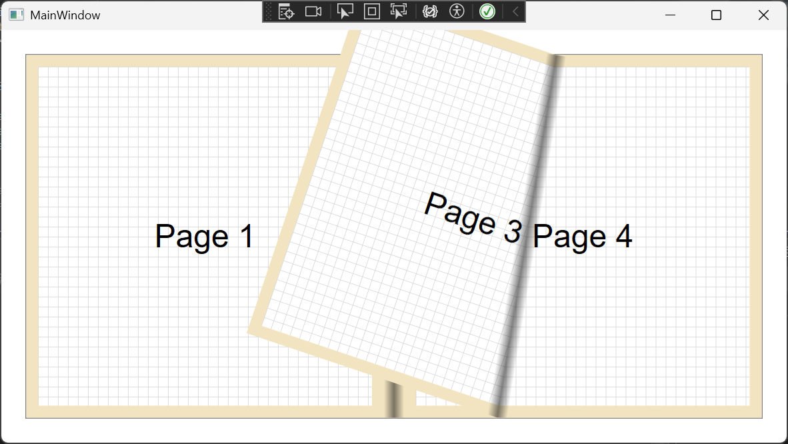

# PageTurningEffect

一个基于 WPF 的仿真翻书控件示例项目，用于演示“双页书籍”场景下的拖拽翻页效果、阴影渲染和自定义内容承载。

## 项目亮点

- 基于 `FrameworkElement` 自定义实现翻页控件 `SimulatedBook`
- 支持鼠标拖拽翻页，并带有缓动动画
- 支持书脊阴影、翻页阴影、页面内边距等视觉参数
- 支持两类内容源：
  - `ControlBookContent`：直接承载 WPF 控件页面
  - `TextBookContent`：基于文本自动分页并绘制页码
- 通过 `IBookContent` 扩展接口支持自定义页面渲染逻辑

## 效果演示



## 运行环境

- Windows
- .NET SDK 10.0（项目目标框架：`net10.0-windows`）
- 支持 WPF 的 IDE，例如 Visual Studio 2022 / 2025 或最新版 VS Code + C# 开发环境

## 快速开始

### 1. 打开项目

直接打开解决方案：

- `PageTurningEffect.sln`

### 2. 运行项目

可使用 Visual Studio 直接启动，或在项目目录执行：

```powershell
dotnet run --project PageTurningEffect.csproj
```

## 当前示例效果

默认窗口中放置了一个 `SimulatedBook` 控件，并通过 `ControlBookContent` 提供了 3 个示例页面，每页包含一个简单按钮，用于演示控件内容的承载与翻页动画。

当前主渲染路径聚焦于 **双页模式**（`BookMode.TwoSide`）：

- 从右往左拖拽：向后翻页
- 从左往右拖拽：向前翻页
- `CurrentPage` 以跨页为单位变化，双页模式下通常按 2 页递进

## 项目结构

```text
PageTurningEffect/
├─ App.xaml                        # WPF 应用入口
├─ MainWindow.xaml                 # 示例窗口
├─ BookContents/
│  ├─ ControlBookContent.cs        # 基于控件树的页面内容
│  ├─ ControlBookPage.cs           # 单个控件页面容器
│  └─ TextBookContent.cs           # 文本自动分页内容
├─ Components/
│  ├─ BookMode.cs                  # 阅读模式枚举
│  ├─ BookPageRenderContext.cs     # 页面绘制上下文
│  ├─ IBookContent.cs              # 内容扩展接口
│  └─ SimulatedBook*.cs            # 翻页控件主体与几何计算
└─ Demo/
   └─ TestBookContent.cs           # 自定义绘制内容示例
```

## 核心设计

### 1. `SimulatedBook`

`SimulatedBook` 是本项目的核心控件，负责：

- 鼠标按下、拖拽、释放的交互处理
- 页面翻转几何计算
- 当前页、目标页与动画状态管理
- 左页 / 右页 / 翻动页三层视觉容器管理
- 页面背景与阴影绘制

可配置属性包括：

- `Mode`
- `Content`
- `Background`
- `SpineShadowSize`
- `TurningShadowSize`
- `Padding`
- `ShadowOpacity`
- `CurrentPage`

### 2. `IBookContent`

所有书籍内容都通过 `IBookContent` 接口接入：

```csharp
public interface IBookContent
{
    int GetPageCount(Size pageSize);
    void RenderPage(BookPageRenderContext context, Size pageSize, int pageIndex);
}
```

这意味着你可以：

- 直接放置 WPF 控件页面
- 绘制文本、图形、矢量内容
- 接入你自己的分页或排版逻辑

### 3. `BookPageRenderContext`

`BookPageRenderContext` 为内容渲染提供两种能力：

- `DrawingContext`：直接绘制矢量内容
- `RegisterElement(UIElement)`：注册一个可参与布局和显示的 WPF 元素

## 使用方式

### 方式一：在 XAML 中直接放置控件页面

适合表单页、图片页、按钮页、说明页等交互式页面。

```xml
<comp:SimulatedBook Background="#f2e4c1"
                    SpineShadowSize="10"
                    TurningShadowSize="10"
                    Padding="12">
    <bc:ControlBookContent>
        <bc:ControlBookPage>
            <StackPanel>
                <TextBlock FontSize="24" Text="第一页" />
                <Button Content="点击我" />
            </StackPanel>
        </bc:ControlBookPage>

        <bc:ControlBookPage>
            <Grid>
                <TextBlock Text="第二页" />
            </Grid>
        </bc:ControlBookPage>
    </bc:ControlBookContent>
</comp:SimulatedBook>
```

### 方式二：在代码中使用文本内容源

适合小说阅读、说明文档、帮助文档等纯文本场景。

```csharp
var content = new TextBookContent(longText, fontSize: 16);
book.Content = content;
```

`TextBookContent` 当前已实现：

- 按页面尺寸自动分页
- 基于文本宽度自动换行
- 页面底部页码绘制

### 方式三：实现自己的内容源

```csharp
public sealed class MyBookContent : IBookContent
{
    public int GetPageCount(Size pageSize) => 6;

    public void RenderPage(BookPageRenderContext context, Size pageSize, int pageIndex)
    {
        var dc = context.DrawingContext;
        dc.DrawRectangle(Brushes.White, null, new Rect(0, 0, pageSize.Width, pageSize.Height));
        dc.DrawText(
            new FormattedText(
                $"Page {pageIndex + 1}",
                CultureInfo.CurrentCulture,
                FlowDirection.LeftToRight,
                new Typeface("Segoe UI"),
                28,
                Brushes.Black,
                1.0),
            new Point(24, 24));
    }
}
```

然后：

```csharp
book.Content = new MyBookContent();
```

## 适用场景

- 电子书/杂志阅读器原型
- 产品画册、相册、作品集展示
- 交互式帮助文档或教程演示
- WPF 自定义控件与图形算法学习

## 已实现内容

- 双页翻页交互
- 基础阴影效果
- 页面尺寸计算
- 控件页内容承载
- 文本内容自动分页
- 自定义渲染扩展接口

## 已知限制

当前项目更偏向 **控件原型 / 效果验证**，在正式业务化之前建议继续完善：

1. `BookMode.OneSide` 已预留，但当前主渲染逻辑主要围绕双页模式。
2. 缺少统一的对外事件，例如“翻页开始 / 翻页结束 / 当前页变化”。
3. 还没有针对高 DPI、触摸输入、键盘翻页做完整适配说明。
4. 暂未提供截图、GIF 或单元测试。
5. 文本分页逻辑当前以基础换行和高度估算为主，复杂排版场景仍可继续增强。

## 后续可扩展方向

- 增加单页模式与封面模式
- 增加触摸手势支持
- 增加翻页事件与命令绑定
- 增加图片/富文本/混合排版内容源
- 增加缓存策略，提升大内容场景性能
- 提供 NuGet 打包与独立示例项目

## 关键源码入口

- `MainWindow.xaml`：示例窗口布局
- `Components/SimulatedBook.cs`：核心翻页控件
- `Components/IBookContent.cs`：内容扩展接口
- `BookContents/ControlBookContent.cs`：控件页面内容源
- `BookContents/TextBookContent.cs`：文本分页内容源
- `Demo/TestBookContent.cs`：自定义绘制示例
